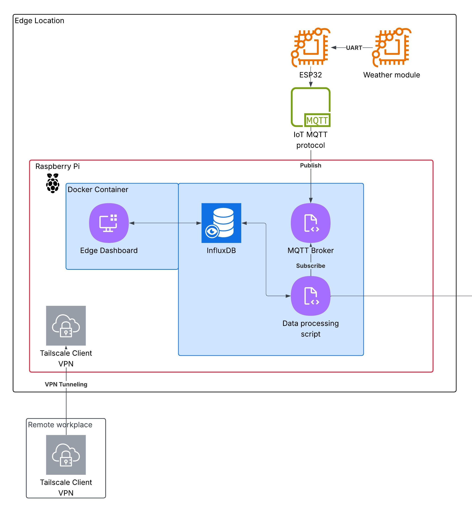
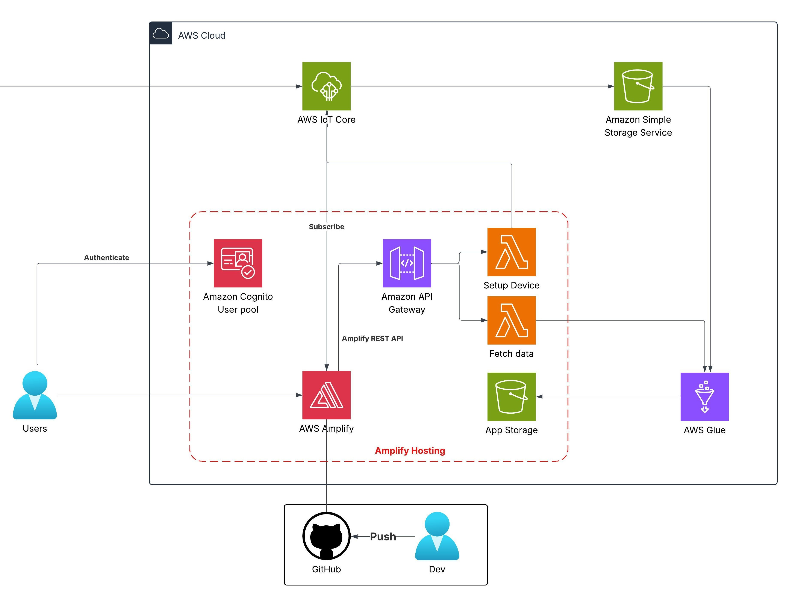

# Automated Legal RAG Platform (Decree 13/2023/ND-CP)
## A Serverless LLM Solution for Real-Time Legal Data Retrieval and Analysis

### 1. Executive Summary
The Automated Legal RAG Platform is designed to assist users and team members in quickly retrieving and analyzing complex legal regulations in Vietnam, specifically focusing on **Decree 13/2023/ND-CP on personal data protection**. The platform leverages a comprehensive Serverless architecture on AWS combined with a powerful Large Language Model via **Groq API (qwen/qwen3.8-27b)**. This solution delivers highly accurate, context-aware queries, eliminating AI hallucination, while minimizing operational costs to nearly $0 by fully utilizing the AWS Free Tier.

### 2. Problem Statement
### What’s the Problem?
* Legal documents such as Decree 13/2023/ND-CP are lengthy, dry, and difficult for non-experts to manually navigate and search.
* Standard general-purpose AI tools (like the free tier of ChatGPT) often lack deep knowledge of Vietnamese law and tend to provide vague answers without an accurate legal basis.
* Building a self-hosted AI system is typically hardware-intensive and requires complex server management.

### The Solution
* Implement an automated **RAG (Retrieval-Augmented Generation)** pipeline: When a user asks a question, the system scans the database to retrieve the most accurate legal clauses and injects them into the System Prompt. The LLM then processes this information to deliver an answer with clear legal citations.
* Utilize **Amazon DynamoDB** to store the extracted legal clauses (`LegalArticles`).
* Use **AWS Lambda** for backend RAG logic processing, combined with **Amazon API Gateway** to provide a stable API Endpoint.
* Integrate **Groq API** with the `qwen/qwen3.8-27b` model for intelligent, coherent natural language generation.
* Host a static web interface on **Amazon S3 Static Website** to allow intuitive user interaction via a chat box.

### Benefits and Return on Investment
* **High Accuracy:** Answers strictly follow the provided legal context, ensuring transparency and valid grounding.
* **Cost Optimization:** Operates entirely on a Serverless model, maximizing the AWS Free Tier to keep monthly maintenance costs at nearly **$0**.
* **Scalability:** The decoupled architecture allows for the easy addition of new legal frameworks (e.g., Cybersecurity Law, IT Law) to DynamoDB in the future.

### 3. Solution Architecture
The system employs a Serverless architecture, seamlessly connecting the Frontend, Backend, and external LLM.

### AWS Services Used
- **Amazon S3 Static Website:** Stores and serves the static website interface (`index.html`, CSS, JS) to users.
- **Amazon API Gateway:** Provides a public HTTP/REST API, handles CORS, and acts as the entry point for client requests to Lambda.
- **AWS Lambda (Python):** Executes the backend source code to process RAG logic, retrieve data from DynamoDB, and interact with the Groq API.
- **Amazon DynamoDB (`LegalArticles`):** Stores the structure of legal clauses, supporting high-speed keyword queries.
- **Groq API (`qwen/qwen3.8-27b`):** Synthesizes and analyzes natural language based on the injected legal context.

### Component Design
- **User Interface (Frontend)**: Users access the website from S3 and type questions into the chat box. The browser sends an HTTPS POST Request containing the question to the API Gateway.
- **Gateway (API Gateway)**: Receives the request, checks CORS security headers, and forwards the data payload to the Lambda function.
- **Data Retrieval (DynamoDB)**: Lambda executes the `retrieve_legal_context` function to scan and search for relevant clauses in the `LegalArticles` table (e.g., penalty regulations related to Citizen ID cards and personal data under Decree 13).
- **Augmentation & Generation (Groq API)**: Lambda packages the user's question along with the retrieved legal context into a strictly constrained System Prompt (enforcing responses based only on the provided context), then calls the Groq API.
- **Response Flow**: Groq returns the result to Lambda, which formats the data into a standard JSON structure and sends it back via API Gateway to be displayed on the user's chat interface.

### 4. Technical Implementation
**Implementation Phases**
This project has two parts—setting up weather edge stations and building the weather platform—each following 4 phases:
1. **Prompt Setup & RAG Mechanism:** Build the System Prompt defining the AI's role as a legal expert and establish Context Constraints to absolutely prevent information fabrication (hallucination).
2. **Backend & Database Deployment:**
* Create the DynamoDB table `LegalArticles`.
* Write Python code on AWS Lambda integrating data retrieval functions and Groq API calls.
* Configure API Gateway, enable CORS Headers, and build standardized error handling (returning code 400 for invalid data, 502/504 for system errors, and handling code 429 for Groq API rate limits).
3. **Testing & Refinement:** Use the curl command to send test HTTP POST requests or test directly on the web interface, and verify logs on Amazon CloudWatch.

### 5. Timeline & Milestones
**Project Timeline**
- **Research & Design Phase:** Define the legal scope (Decree 13/2023/ND-CP) and design the RAG data flow.
- **Development & Deployment Phase:** Build the DynamoDB database, complete the Lambda function, and configure the API Gateway.
- **Integration & Testing Phase:** Connect the S3 Static Website frontend with the API Gateway, test the accuracy of answers from the Groq LLM, and optimize error handling.

### 6. Budget Estimation

- **AWS Infrastructure:**
* Amazon S3: Free (within Free Tier limits).
* Amazon API Gateway: Free (first 1 million requests/month).
* AWS Lambda: Free (first 1 million requests/month).
* Amazon DynamoDB: Free (25GB storage, 25 WCU / 25 RCU).
- **Groq API:** Free tier utilized for the open-source model (`qwen/qwen3.8-27b`).

*Total*: 0 USD

### 7. Risk Assessment
#### API Overload (Rate Limit 429 from Groq API):
- Mitigation: Implement Error Handling mechanisms and display friendly notification messages on the chat interface when the system temporarily exceeds call frequency limits.

#### AI Hallucination:
- Mitigation: Tighten the System Prompt with strict rules requiring the use of only the legal context provided by DynamoDB, strictly forbidding external deduction or fabrication.

#### Browser CORS Errors:
- Mitigation: Fully configure CORS Headers (`Access-Control-Allow-Origin: *, POST, OPTIONS`) directly within the API Gateway settings.

### 8. Expected Outcomes
#### Technical Improvements: 
Successfully deploy a complete, auto-scaling, and stable Serverless Backend while optimizing costs to an absolute minimum ($0).
#### Long-term Value
Provide a standardized API endpoint and an intuitive chat interface to quickly and accurately query core regulations within Decree 13/2023/ND-CP, effectively serving academic research and practical study needs.