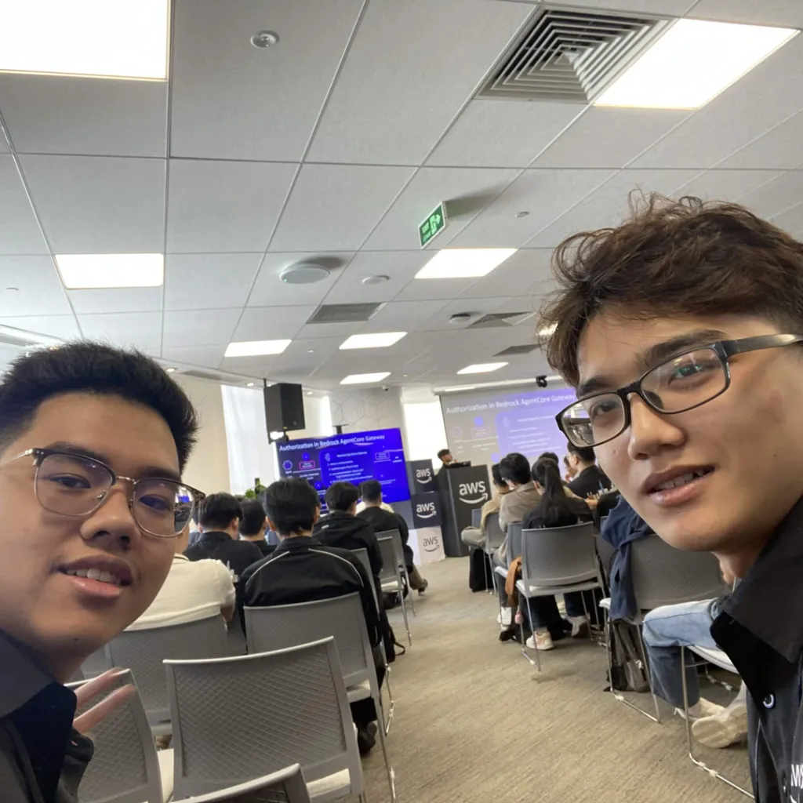
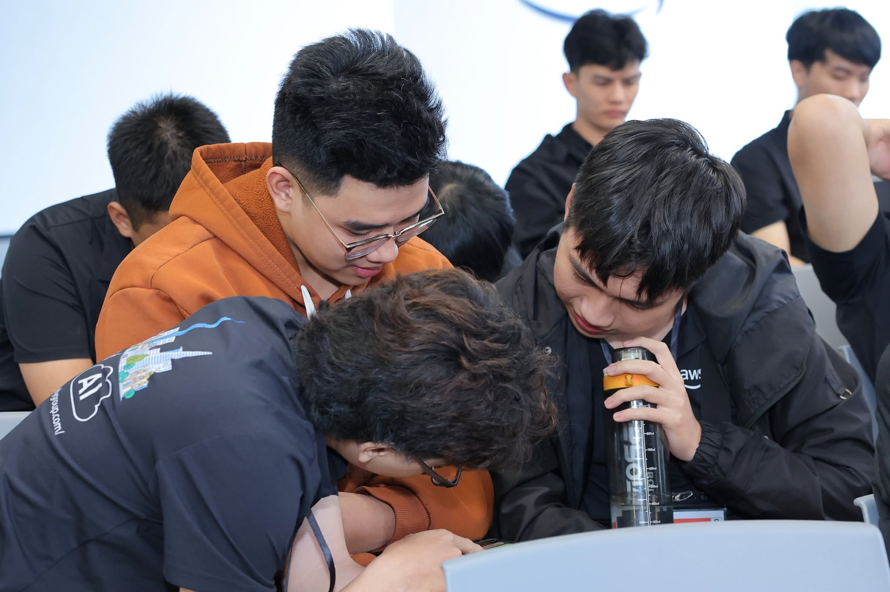
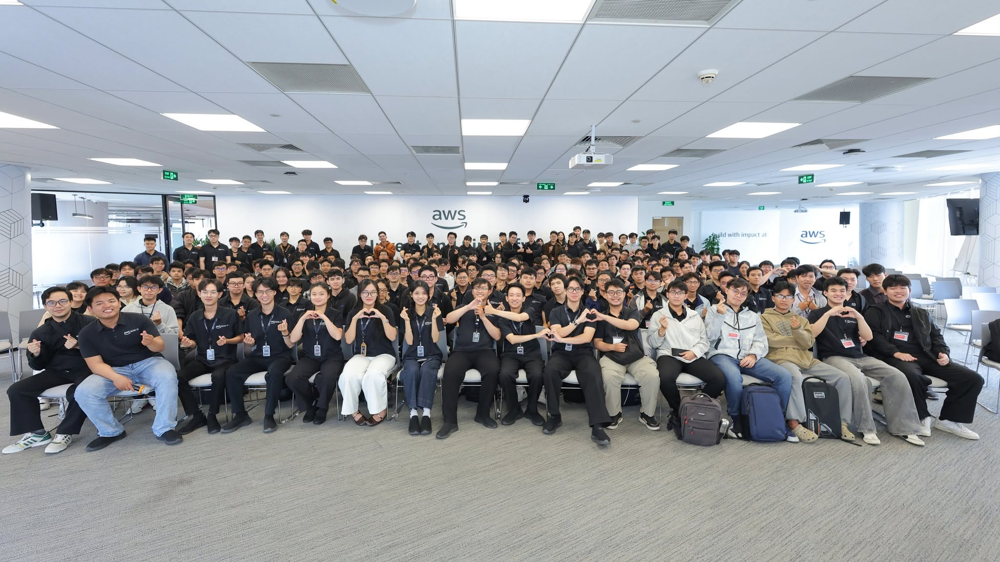

# Summary Report: “Cloud Mastery”

### Event Objectives

#### Event Introduction

The "Cloud Mastery" event series in Ho Chi Minh City consists of hands-on workshops covering cloud computing (AWS), AI/ML/GenAI, DevOps, and security, designed for technology students and the IT community.

#### Target Audience & Cost:

Ideal for IT students, those interested in AI/ML, and individuals pursuing a career in cloud computing. Community workshops are generally free to attend upon prior registration.

#### Event Topics:

- **AI/ML/GenAI on AWS:** Mastering Amazon SageMaker and Bedrock, building GenAI chatbots, implementing RAG (Retrieval-Augmented Generation), and prompt engineering.
- **DevOps on AWS:** DevOps mindset, CI/CD pipelines, Infrastructure as Code (IaC), and containerization on AWS.
- **Security on AWS:** Zero Trust Architecture, IAM, KMS, GuardDuty, continuous monitoring, and the security pillars of the AWS Well-Architected Framework.

#### Event Experience

Attending the **Cloud Mastery** event at the Bitexco building offered a highly practical and focused learning experience, helping me solidify my knowledge across AI/ML, DevOps, and cloud security. Key highlights included:

#### Access to Hands-on, Multi-disciplinary Knowledge on AWS

- The atmosphere at the community workshop was open and engaging, bringing together IT students and young professionals with a shared interest in cloud careers.
- Rather than presenting isolated theoretical concepts, the content was structured into clear, core pillars. This helped me easily visualize the "big picture" of how a complete cloud system operates—from development and deployment to security and protection. #### In-depth Experience with AI/ML/GenAI and DevOps

- In the realm of AI/ML/GenAI, I gained proficiency in using Amazon SageMaker and Amazon Bedrock, and learned to integrate Prompt Engineering with RAG (Retrieval-Augmented Generation) to build intelligent, data-grounded chatbot applications.
- Regarding DevOps, the workshop helped me formalize my approach to automation through CI/CD pipelines, Infrastructure as Code (IaC), and the flexible deployment of containers on AWS.

#### Strengthening Security Mindset and System Defense

* The "Security on AWS" module provided a sharp perspective on Zero Trust architecture. I gained a deeper understanding of how to orchestrate core services—such as IAM (for identity and access management), KMS (for data encryption), and GuardDuty (for continuous monitoring and threat detection)—in alignment with the AWS Well-Architected Framework.

#### Key Takeaways

- **Security by Design:** Whether building GenAI applications or implementing automated CI/CD pipelines, applying Zero Trust principles, enforcing strict IAM-based access controls, and maintaining continuous monitoring are essential for secure system operations.
- **Automation as a Catalyst for Speed:** Adopting a DevOps mindset—leveraging IaC and containers—minimizes manual errors and accelerates the time-to-market for products.
- **Selecting the Right Tools for AI Challenges:** Mastering the ecosystem, from Amazon Bedrock to RAG, enables the efficient development of GenAI applications without the need to retrain models from scratch.

#### Photos from the event

