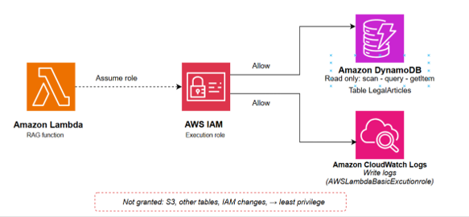
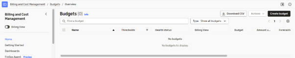
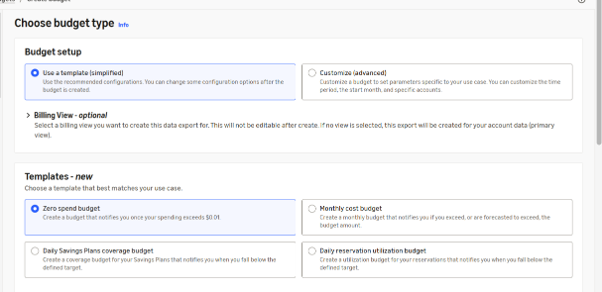
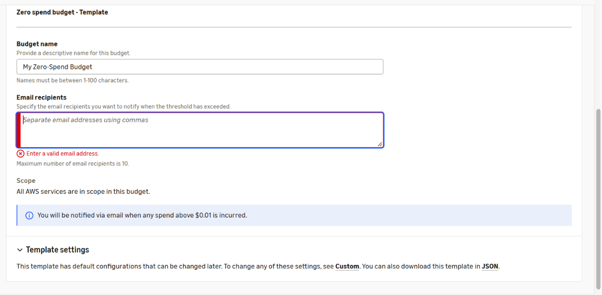
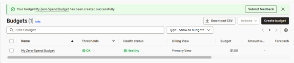

#### AWS account and region

All resources are created in one region: ap-southeast-2 (Asia Pacific – Sydney), as seen in the website URL. Enable MFA on the root user and work with an IAM user, not root.

#### IAM role for Lambda

Lambda needs only two things: read the LegalArticles table and write logs. Replace the placeholders with your account ID and region.

```
{
  "Version": "2012-10-17",
  "Statement": [
    {
      "Sid": "ReadLegalArticles",
      "Effect": "Allow",
      "Action": [
        "dynamodb:Scan",
        "dynamodb:Query",
        "dynamodb:GetItem"
      ],
      "Resource": "arn:aws:dynamodb:ap-southeast-2:<ACCOUNT_ID>:table/LegalArticles"
    },
    {
      "Sid": "CreateLogGroup",
      "Effect": "Allow",
      "Action": "logs:CreateLogGroup",
      "Resource": "arn:aws:logs:ap-southeast-2:<ACCOUNT_ID>:*"
    },
    {
      "Sid": "WriteLogs",
      "Effect": "Allow",
      "Action": [
        "logs:CreateLogStream",
        "logs:PutLogEvents"
      ],
      "Resource": "arn:aws:logs:ap-southeast-2:<ACCOUNT_ID>:log-group:/aws/lambda/legal-ai-chat-lambda:*"
    }
  ]
}

```

Also attach the AWS managed policy AWSLambdaBasicExecutionRole so Lambda can write to CloudWatch Logs.



#### Groq account and API key

Create an API Key on Groq and select a model in the Playground <br>
Create an account and access the Groq Console
1. Go to **console.groq.com** and log in (or sign up for a new account).
2. Once logged in, you will see the **Dashboard** page of the Groq Console.


3. Groq Dashboard:
* You can view your **Token Usage** for the last 30 days.
* Shortcuts for **Playground**, **Docs**, and **Manage Team** allow you to test models, access documentation, and manage team members.
* In the top-right menu bar, select **API Keys** to navigate to the key management page.
4. Creating an API Key:


* On the **API Keys** page, you will see a list of the project's keys. Since no keys have been created yet, the table displays **(No keys)**.
* Select **Create API Key** in the top-right corner.
5. In the **Create API Key** dialog box:
* **Display Name**: Enter a descriptive name for the key (up to 50 characters).
* Select **Submit**.


6. The system displays the API key in the format `gsk…`.


API key successfully created:
* Select **Copy** to copy the key.
* **Note:** The key is displayed only once. Please save it in a secure location immediately, as it cannot be viewed again after closing this window.
* Select **Done** to finish.
7. Select a model in the Playground


* In the menu bar, select **Playground**.
* In the model selection box at the top, choose the model you wish to use—in this case, `qwen/qwen3.8-27b`.
* Click **View code** (which will change to **Hide code** when active) to display a code sample for calling the API with the currently selected model.

#### Tools

* VS Code, Git
* Python (same version as the Lambda runtime)
* curl (to test the API)

#### Danh mục tài nguyên

| Resource | Name | Note |
| -------- | ---- | ---- |
| S3 Bucket | ai-legal-assistant-frontend-hau | Static website hosting |
| DynamoDB | LegalArticles | Knowledge base |
| Lambda | Team's Lambda function | Python |
| API Gateway | Team's API | Public endpoint called by the website |

#### Budget alert

Create an AWS Budget with an email alert before building anything. The project target is $0 on Free Tier; an alert catches surprises.

#### Open the Budgets page

1. In the AWS Management Console, type "Billing and Cost Management" into the search box and press Enter.
2. In the left-hand menu, select **Budgets**.

The Budgets page is currently empty.

1: Budgets page; the list is currently empty (0 budgets).
* The table displays **No budgets**, indicating that there are no cost alerts set up for the account.
* Select **Create budget** in the top-right corner. <br>
**Select Budget Type** <br>
3: On the **Choose budget type** page: <br>
Select the **Zero spend budget** template.


2: Select "Use a template" and the "Zero spend budget" template.
* **Budget setup:** Choose **Use a template (simplified)** (to use a pre-configured, recommended setup). The **Customize (advanced)** option allows for more detailed configuration, but it is not necessary here.
* **Templates:** Select **Zero spend budget**, which will notify you as soon as spending exceeds $0.01. Other templates (Monthly cost budget, Savings Plans, Reservation) are not suitable for a $0 spending goal.
* **Billing View** is optional; you can skip it.
* Scroll to the bottom of the page and select **Next**. <br>
**Set a name and an email address for receiving alerts**
4. On the **Zero spend budget - Template** page: <br>
Enter the name and email address.


3: Name your budget and enter the email address for notifications
* **Budget name:** Keep the default name, "My Zero-Spend Budget," or choose something more descriptive, such as "LegalRAG-Zero-Spend."
* **Email recipients:** Enter the email address(es) to receive alerts. You can provide multiple addresses separated by commas (up to 10). The error message "Enter a valid email address" appears in red because the field is currently empty; please enter a valid email address to resolve this.
* **Scope:** Select "All AWS services" to apply the budget to every service in your account.
* The system specifies that you will receive an email notification whenever any charge exceeds $0.01.
* **Template settings:** Keep the default values ​​(these can be adjusted later).
* Select **Create budget**.


4: The budget has been successfully created and is in a "Healthy" state.
* Notification: "Your budget 'My Zero-Spend Budget' has been created successfully."
* The "Budgets (1)" list displays the new budget with "Thresholds: OK" and "Health status: Healthy," indicating that no costs have exceeded the threshold.
* The budget amount is $1.00, which is the baseline value from the template (the alert threshold remains $0.01).

#### Legal documents

Source: Decree 13/2023/ND-CP. Before the demo, check which documents are currently in force and whether newer laws amend or replace parts of the decree.