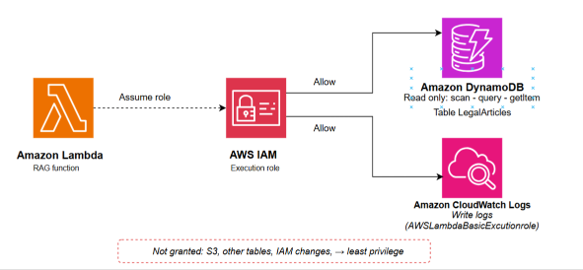

#### AWS account and region

All resources are created in one region: ap-southeast-2 (Asia Pacific – Sydney), as seen in the website URL. Enable MFA on the root user and work with an IAM user, not root.

#### IAM role for Lambda

Lambda needs only two things: read the LegalArticles table and write logs. Replace the placeholders with your account ID and region.

```
{
    "Version": "2012-10-17",
    "Statement": [
        {
            "Effect": "Allow",
            "Action": "logs:CreateLogGroup",
            "Resource": "arn:aws:logs:ap-southeast-2:322440665897:*"
        },
        {
            "Effect": "Allow",
            "Action": [
                "logs:CreateLogStream",
                "logs:PutLogEvents"
            ],
            "Resource": [
                "arn:aws:logs:ap-southeast-2:322440665897:log-group:/aws/lambda/legal-ai-chat-lambda:*"
            ]
        }
    ]
}
```

Also attach the AWS managed policy AWSLambdaBasicExecutionRole so Lambda can write to CloudWatch Logs.



#### Groq account and API key

Create an account at console.groq.com and generate an API key. The key goes into a Lambda environment variable (GROQ_API_KEY). Never put it in index.html, Git or screenshots.


#### Tools

* VS Code, Git
* Python (same version as the Lambda runtime)
* curl (to test the API)

#### Danh mục tài nguyên

| Resource | Name | Note |
| -------- | ---- | ---- |
| S3 Bucket | ai-legal-assistant-frontend-hau | Static website hosting |
| DynamoDB | LegalArticles | Knowledge base |
| Lambda | Team's Lambda function | Python |
| API Gateway | Team's API | Public endpoint called by the website |

#### Budget alert

Create an AWS Budget with an email alert before building anything. The project target is $0 on Free Tier; an alert catches surprises.

[ INSERT SCREENSHOT ]

AWS Budget alert configured

5.2-Prerequisite/budget-alert.png

#### Legal documents

Source: Decree 13/2023/ND-CP. Before the demo, check which documents are currently in force and whether newer laws amend or replace parts of the decree.