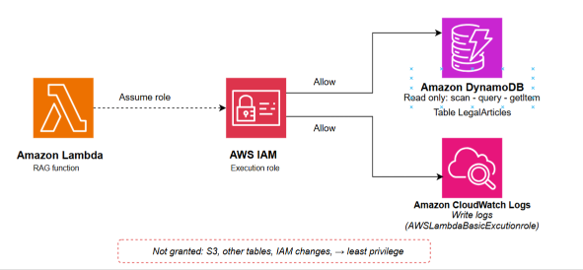
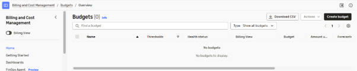
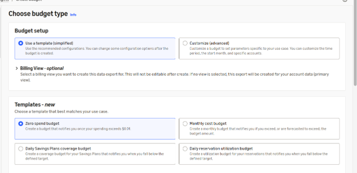
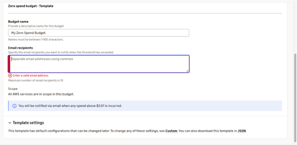
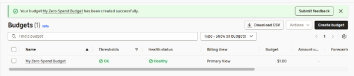

#### Tài khoản AWS và region

Toàn bộ tài nguyên tạo trong một region: ap-southeast-2 (Asia Pacific – Sydney), theo URL của website. Bật MFA cho root và làm việc bằng IAM user, không dùng root.

#### IAM role cho Lambda

Lambda chỉ cần hai quyền: đọc bảng LegalArticles và ghi log. Thay phần giữ chỗ bằng account ID và region của bạn.

```
{
  "Version": "2012-10-17",
  "Statement": [
    {
      "Sid": "ReadLegalArticles",
      "Effect": "Allow",
      "Action": [
        "dynamodb:Scan",
        "dynamodb:Query",
        "dynamodb:GetItem"
      ],
      "Resource": "arn:aws:dynamodb:ap-southeast-2:<ACCOUNT_ID>:table/LegalArticles"
    },
    {
      "Sid": "CreateLogGroup",
      "Effect": "Allow",
      "Action": "logs:CreateLogGroup",
      "Resource": "arn:aws:logs:ap-southeast-2:<ACCOUNT_ID>:*"
    },
    {
      "Sid": "WriteLogs",
      "Effect": "Allow",
      "Action": [
        "logs:CreateLogStream",
        "logs:PutLogEvents"
      ],
      "Resource": "arn:aws:logs:ap-southeast-2:<ACCOUNT_ID>:log-group:/aws/lambda/legal-ai-chat-lambda:*"
    }
  ]
}

```

Gắn thêm managed policy AWSLambdaBasicExecutionRole để Lambda ghi được log vào CloudWatch.



#### Tài khoản Groq và API key

Tạo API Key trên Groq và chọn model trong Playground <br>
Tạo tài khoản và truy cập Groq Console
1. Truy cập **console.groq.com** và đăng nhập (hoặc đăng ký tài khoản mới).
2. Khi đăng nhập, sẽ thấy trang **Dashboard** của Groq Console.


3. Trang Dashboard Groq:
* Có thể xem lượng **Token Usage** trong 30 ngày gần nhất.
* Các lối tắt **Playground**, **Docs**, **Manage Team** giúp chat thử với model, xem tài liệu và quản lý thành viên.
* Ở thanh menu phía trên bên phải, chọn **API Keys** để chuyển sang trang quản lý key.
4. Tạo API Key:


* Tại trang **API Keys**, bạn sẽ thấy danh sách key của dự án. Vì chưa tạo key nào nên bảng đang hiển thị **(No keys)**. 
* Chọn Create API Key ở góc phải.
5. Trong hộp thoại **Create API Key**:
* **Display Name**: đặt tên gợi nhớ cho key, tối đa 50 ký tự.
* Chọn **Submit**.


6. Hệ thống hiển thị API key dạng `gsk…`.


API key vừa được tạo:
* Chọn **Copy** để sao chép key.
* **Lưu ý:** key chỉ hiển thị một lần duy nhất. Hãy lưu ngay vào nơi an toàn, vì sau khi đóng cửa sổ sẽ không xem lại được.
* Chọn **Done** để hoàn tất.
7. Chọn model trong Playground


* Trên thanh menu, chọn **Playground**.
* Ở ô chọn model phía trên, chọn model muốn dùng. Trong bài này là `qwen/qwen3.8-27b`.
* Chọn **View code** (khi đang mở sẽ hiển thị **Hide code**) để xem đoạn code mẫu gọi API cho đúng model đang chọn.

#### Danh mục tài nguyên

| Tài nguyên | Tên | Ghi chú |
| ---------- | --- | ------- |
| S3 Bucket | ai-legal-assistant-frontend-hau | Static website hosting |
| DynamoDB | LegalArticles | Cơ sở tri thức |
| Lambda | Hàm Lambda của nhóm | Python |
| API Gateway | API của nhóm | Endpoint công khai cho website gọi |

#### Cảnh báo chi phí

Tạo AWS Budget có cảnh báo email trước khi xây bất cứ thứ gì. Mục tiêu dự án là $0 trong Free Tier; cảnh báo giúp phát hiện bất thường.

#### Mở trang Budgets

1. Trong AWS Management Console, gõ Billing and Cost Management vào ô tìm kiếm và nhấn Enter.
2. Ở menu bên trái, chọn **Budgets**.

Trang Budgets đang trống.

1: Trang Budgets, danh sách đang trống (0 budgets)
* Bảng hiển thị **No budgets**, nghĩa là tài khoản chưa có cảnh báo chi phí nào.
* Chọn **Create budget** ở góc phải. <br>
**Chọn loại Budget** <br>
3: Ở trang **Choose budget type:** <br>
Chọn template Zero spend budget 


2: Chọn Use a template và template Zero spend budget
* **Budget setup:** chọn **Use a template (simplified)** (dùng cấu hình khuyến nghị có sẵn). Tùy chọn **Customize (advanced)** cho phép chỉnh chi tiết hơn nhưng không cần thiết ở đây.
* **Templates:** chọn **Zero spend budget**, tức là báo cho bạn ngay khi chi tiêu vượt $0.01. Các template khác (Monthly cost budget, Savings Plans, Reservation) không phù hợp với mục tiêu $0.
* **Billing View** là tùy chọn, bỏ qua.
* Kéo xuống cuối trang và chọn **Next**. <br>
**Đặt tên và email nhận cảnh báo**
4. Ở trang **Zero spend budget - Template**: <br>
Điền tên và email


3: Đặt tên budget và nhập email nhận thông báo
* **Budget name:** giữ tên mặc định My Zero-Spend Budget hoặc đặt tên gợi nhớ hơn, ví dụ LegalRAG-Zero-Spend.
* **Email recipients:** nhập email nhận cảnh báo, nhiều email cách nhau bằng dấu phẩy (tối đa 10). Ảnh đang báo đỏ **Enter a valid email address** vì ô còn trống, hãy nhập email thật của bạn để hết lỗi.
* **Scope: All AWS services**, áp dụng cho toàn bộ dịch vụ trong tài khoản.
* Hệ thống ghi rõ: bạn sẽ nhận email khi có bất kỳ khoản chi nào trên $0.01.
* **Template settings** giữ mặc định (có thể chỉnh sau).
* Chọn **Create budget**.


4: Budget đã được tạo thành công và đang ở trạng thái Healthy
* Thông báo Your budget My Zero-Spend Budget has been created successfully.
* Danh sách Budgets (1) hiển thị budget mới với Thresholds: OK và Health status: Healthy, nghĩa là hiện chưa có chi phí nào vượt ngưỡng.
* Cột Budget là $1.00, đây là mức nền của template (ngưỡng cảnh báo vẫn là $0.01).

#### Tài liệu pháp luật

Nguồn: Nghị định 13/2023/NĐ-CP. Trước khi demo, kiểm tra văn bản nào đang có hiệu lực và có luật mới sửa đổi hoặc thay thế một phần nghị định hay không.