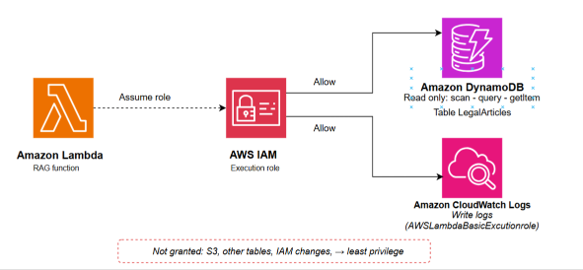

#### Tài khoản AWS và region

Toàn bộ tài nguyên tạo trong một region: ap-southeast-2 (Asia Pacific – Sydney), theo URL của website. Bật MFA cho root và làm việc bằng IAM user, không dùng root.

#### IAM role cho Lambda

Lambda chỉ cần hai quyền: đọc bảng LegalArticles và ghi log. Thay phần giữ chỗ bằng account ID và region của bạn.

```
{
    "Version": "2012-10-17",
    "Statement": [
        {
            "Effect": "Allow",
            "Action": "logs:CreateLogGroup",
            "Resource": "arn:aws:logs:ap-southeast-2:322440665897:*"
        },
        {
            "Effect": "Allow",
            "Action": [
                "logs:CreateLogStream",
                "logs:PutLogEvents"
            ],
            "Resource": [
                "arn:aws:logs:ap-southeast-2:322440665897:log-group:/aws/lambda/legal-ai-chat-lambda:*"
            ]
        }
    ]
}
```

Gắn thêm managed policy AWSLambdaBasicExecutionRole để Lambda ghi được log vào CloudWatch.



#### Tài khoản Groq và API key

Tạo API Key trên Groq và chọn model trong Playground
Tạo tài khoản và truy cập Groq Console
1. Truy cập **console.groq.com** và đăng nhập (hoặc đăng ký tài khoản mới).
2. Khi đăng nhập, sẽ thấy trang **Dashboard** của Groq Console.


3. Trang Dashboard Groq:
* Có thể xem lượng **Token Usage** trong 30 ngày gần nhất.
* Các lối tắt **Playground**, **Docs**, **Manage Team** giúp chat thử với model, xem tài liệu và quản lý thành viên.
* Ở thanh menu phía trên bên phải, chọn **API Keys** để chuyển sang trang quản lý key.
4. Tạo API Key:


* Tại trang **API Keys**, bạn sẽ thấy danh sách key của dự án. Vì chưa tạo key nào nên bảng đang hiển thị **(No keys)**. 
* Chọn Create API Key ở góc phải.
5. Trong hộp thoại **Create API Key**:
* **Display Name**: đặt tên gợi nhớ cho key, tối đa 50 ký tự
* **Expiration**: chọn thời hạn của key.
* Chọn **Submit**.


6. Hệ thống hiển thị API key dạng `gsk…`.


API key vừa được tạo:
* Chọn **Copy** để sao chép key.
* **Lưu ý:** key chỉ hiển thị một lần duy nhất. Hãy lưu ngay vào nơi an toàn, vì sau khi đóng cửa sổ sẽ không xem lại được.
* Chọn **Done** để hoàn tất.
7. Chọn model trong Playground


* Trên thanh menu, chọn **Playground**.
* Ở ô chọn model phía trên, chọn model muốn dùng. Trong bài này là `qwen/qwen3.8-27b`.
* Chọn **View code** (khi đang mở sẽ hiển thị **Hide code**) để xem đoạn code mẫu gọi API cho đúng model đang chọn.

#### Danh mục tài nguyên

| Tài nguyên | Tên | Ghi chú |
| ---------- | --- | ------- |
| S3 Bucket | ai-legal-assistant-frontend-hau | Static website hosting |
| DynamoDB | LegalArticles | Cơ sở tri thức |
| Lambda | Hàm Lambda của nhóm | Python |
| API Gateway | API của nhóm | Endpoint công khai cho website gọi |

#### Cảnh báo chi phí

Tạo AWS Budget có cảnh báo email trước khi xây bất cứ thứ gì. Mục tiêu dự án là $0 trong Free Tier; cảnh báo giúp phát hiện bất thường.

[ CHÈN ẢNH CHỤP ]

Đã cấu hình cảnh báo AWS Budget

5.2-Prerequisite/budget-alert.png

#### Tài liệu pháp luật

Nguồn: Nghị định 13/2023/NĐ-CP. Trước khi demo, kiểm tra văn bản nào đang có hiệu lực và có luật mới sửa đổi hoặc thay thế một phần nghị định hay không.