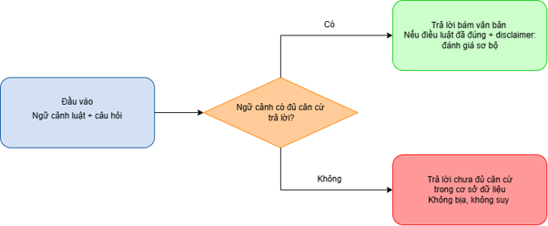
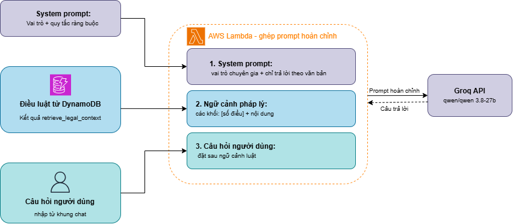

#### Overview

| Item         | Content                                                                                |
| ------------ | -------------------------------------------------------------------------------------- |
| Purpose      | Define how the language model receives and handles legal data before writing any code. |
| AWS services | None (design work; tested in the Groq playground).                                     |
| Output       | A system prompt and a prompt template used by Lambda.                                  |

#### 5.3.1. Build a role-defining system prompt

* Goal

Make the model act as a legal consultant specialized in Vietnamese regulations such as Decree 13/2023/ND-CP.

* Steps

1. Write the role statement (expert in Vietnamese personal-data law).
2. Require answers in Vietnamese and citing the article used.
3. Add the disclaimer: preliminary answer, not official legal advice.
4. Test the draft in the Groq playground.

* Verify

The model answers in the intended role and tone.

#### 5.3.2. Set the context constraint

* Goal

Force the model to answer only from the legal text retrieved from the database.

* Steps

1. Add the strict rule: answer only from the provided legal text; never invent or extrapolate.
2. Add a fallback: if the provided text is not enough, say that there is not enough basis.
3. Test with an out-of-scope question (for example, a tax question).

* Verify

An out-of-scope question gets a 'not enough basis' answer instead of an invented one.

#### 5.3.3. Define the input structure

* Goal

Decide how Lambda injects DynamoDB data into the prompt sent to the model.

* Steps

1. Format each retrieved article as a labelled block (article number + content).
2. Place the legal context before the user's question in the message.
3. Limit the number and length of articles to stay within the model's rate and token limits.

* Verify

A printed prompt shows the three parts in the intended order.