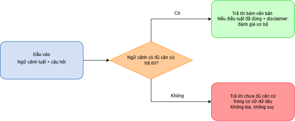

#### Tổng quan

| Mục         | Nội dung                                                                           |
| Mục đích    | Định hình cách mô hình ngôn ngữ nhận và xử lý dữ liệu pháp lý trước khi viết code. |
| Dịch vụ AWS | Không (thiết kế; test trong Groq playground).                                      |
| Đầu ra      | System prompt và mẫu prompt dùng trong Lambda.                                     |

#### 5.3.1. Xây dựng System Prompt định hướng vai trò

* Mục tiêu

Ép mô hình đóng vai chuyên gia tư vấn pháp luật về các quy định tại Việt Nam, như Nghị định 13/2023/NĐ-CP.

* Các bước

1. Viết câu định nghĩa vai trò (chuyên gia luật dữ liệu cá nhân Việt Nam).
2. Yêu cầu trả lời bằng tiếng Việt và nêu điều luật đã dùng.
3. Thêm disclaimer: câu trả lời sơ bộ, không phải tư vấn pháp lý chính thức.
4. Thử bản nháp trong Groq playground.

* Kiểm tra

Mô hình trả lời đúng vai trò và giọng điệu mong muốn.

#### 5.3.2. Thiết lập ràng buộc ngữ cảnh

* Mục tiêu

Buộc mô hình chỉ trả lời dựa trên văn bản pháp luật lấy từ cơ sở dữ liệu.

* Các bước

1. Thêm quy tắc nghiêm ngặt: chỉ trả lời dựa trên văn bản pháp luật được cung cấp; không bịa đặt hay suy diễn ngoài luồng.
2. Thêm phương án dự phòng: nếu văn bản được cung cấp không đủ, nói rõ là chưa đủ căn cứ.
3. Test bằng câu hỏi ngoài phạm vi (ví dụ câu hỏi về thuế).

* Kiểm tra

Câu hỏi ngoài phạm vi nhận câu trả lời 'chưa đủ căn cứ' thay vì câu trả lời bịa.

#### 5.3.3. Xác định cấu trúc dữ liệu đầu vào

* Mục tiêu

Quyết định cách Lambda tiêm (inject) dữ liệu DynamoDB vào prompt gửi đi.

* Các bước

1. Định dạng mỗi điều luật truy xuất thành một khối có nhãn (số điều + nội dung).
2. Đặt ngữ cảnh luật trước câu hỏi của người dùng trong message.
3. Giới hạn số lượng và độ dài điều luật để nằm trong giới hạn rate và token của mô hình.
4. Ghi mẫu cuối cùng vào docs/.

* Kiểm tra

Prompt in ra có đủ ba phần đúng thứ tự.