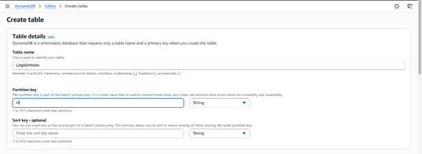
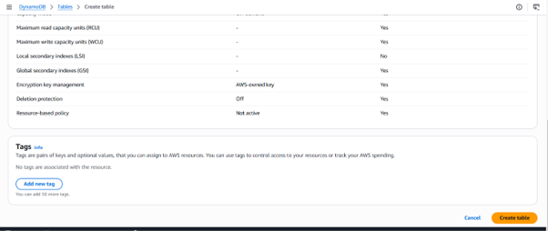
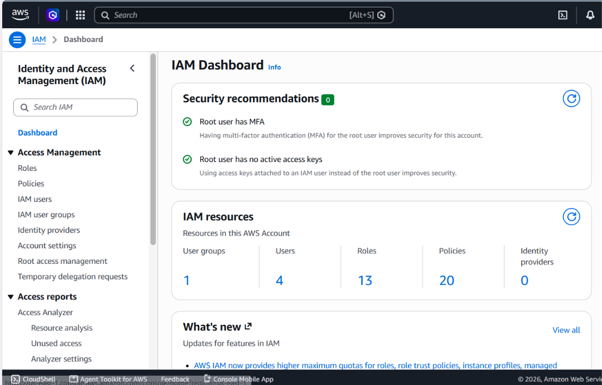
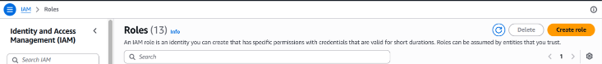
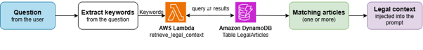

#### Overview

| Item         | Content                                                                                     |
| ------------ | ------------------------------------------------------------------------------------------- |
| Purpose      | A serverless backend that retrieves legal articles, calls the LLM and exposes a stable API. |
| AWS services | DynamoDB, Lambda, API Gateway, CloudWatch.                                                  |
| Input        | HTTP POST with the user's question.                                                         |
| Output       | Standard JSON with the answer or an error code.                                             |
| Depends on   | Phase 1 prompt; Groq API key.                                                               |

#### 5.4.1. Build the knowledge base on DynamoDB

**Goal**  
Store legal articles in a table that Lambda can query.  
**Steps**  
1. Create the table LegalArticles .
- In the AWS Management Console, enter "DynamoDB" into the search box and press Enter.
- From the left-hand menu, select **Tables**, then choose **Create table**.

- In the **Table details** section:
* **Table name:** Set the table name to `LegalArticles`. The name must be between 3 and 255 characters long and may only contain letters, numbers, underscores (_), hyphens (-), and periods (.).
* **Partition key:** Enter `id` with the type **String**. This serves as the primary key used to identify each legal article. DynamoDB hashes this value to determine where to store or retrieve an item.
* **Sort key** (optional): Leave this blank, as the table only requires a single key (`id`).
- Use the default settings and click the **Create table** button.

* After creating the table, the `LegalArticles` table will transition to an **Active** status within a few seconds. The following steps will add the legal provisions from Decree 13/2023/NĐ-CP to this table.

2. Prepare an IAM Role for Lambda
- In the AWS Management Console, type "IAM" into the search bar and press Enter.
- IAM Dashboard page

* The **Security recommendations** section indicates that the account has met two security recommendations: MFA is enabled for the root user, and the root user has no active access keys. This aligns with best practices: enabling MFA for the root user and performing tasks using an IAM user.
* The **IAM resources** section provides a summary of existing resources: 1 user group, 4 users, 13 roles, 20 policies, and 0 identity providers.
* The left-hand menu includes options such as **Roles**, **Policies**, and **IAM users**. We will use **Roles** to create a role for Lambda.
- From the left-hand menu, select **Roles**.  
Roles list page  
* This page displays the list of **Roles (13)** in the account. A role is an identity with specific permissions that uses temporary security credentials; it can be assumed by trusted entities (such as Lambda). 
* Select **Create role** in the top-right corner to create a new role.

- When creating a role, configure it as follows:
* **Trusted entity type:** select **AWS service**; **Use case:** select **Lambda**.
* **Permissions:** attach the managed policy `AWSLambdaBasicExecutionRole` to allow the Lambda function to write logs to CloudWatch, and add a policy that grants read access to the `LegalArticles` table (ensure only the minimum necessary permissions are granted).
* **Role name:** provide a descriptive name, for example, `legal-ai-chat-role`.
* Select **Create role**.

Retrieving articles from DynamoDB (retrieve_legal_context)

**Verify**  
The table returns the expected articles when scanned in the console.

Limitation: lookup is keyword-based, so a question using different wording may miss the right article.

####