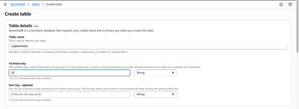
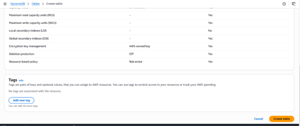
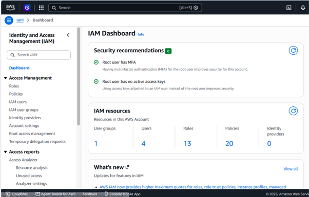
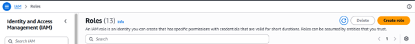
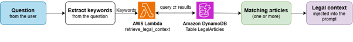

#### Tổng quan

| Mục         | Nội dung                                                                 |
| ----------- | ------------------------------------------------------------------------ |
| Mục đích    | Backend serverless truy xuất điều luật, gọi LLM và cung cấp API ổn định. |
| Dịch vụ AWS | DynamoDB, Lambda, API Gateway, CloudWatch.                               |
| Đầu vào     | HTTP POST chứa câu hỏi của người dùng.                                   |
| Đầu ra      | JSON chuẩn chứa câu trả lời hoặc mã lỗi.                                 |
| Phụ thuộc   | Prompt ở Giai đoạn 1; Groq API key.                                      |

#### 5.4.1. Xây dựng Knowledge Base trên DynamoDB

**Mục tiêu**  
Lưu các điều luật vào bảng mà Lambda truy vấn được.  
**Các bước**  
1. Tạo bảng DynamoDB LegalArticles.
- Trong AWS Management Console, gõ DynamoDB vào ô tìm kiếm và nhấn Enter.
- Ở menu bên trái chọn **Tables**, sau đó chọn **Create table**.

- Trong phần **Table details**:
* **Table name:** đặt tên bảng là LegalArticles. Tên dài 3-255 ký tự, chỉ gồm chữ, số, dấu gạch dưới (_), gạch ngang (-) và dấu chấm (.).
* **Partition key:** nhập id, kiểu **String**. Là khóa chính dùng để định danh từng điều luật. DynamoDB băm giá trị này để biết lưu và tìm item ở đâu.
* **Sort key** (tùy chọn): để trống vì bảng chỉ cần một khóa là id.
- Cài đặt mặc định và nút Create table

* Create table, sau vài giây, bảng LegalArticles chuyển sang trạng thái **Active**. Các bước sau sẽ thêm các điều luật của Nghị định 13/2023/NĐ-CP vào bảng này.

2. Chuẩn bị IAM Role cho Lambda
- Trong AWS Management Console, gõ IAM vào ô tìm kiếm và nhấn Enter. 
- Trang IAM Dashboard

* Mục **Security recommendations** cho thấy tài khoản đã đạt hai khuyến nghị bảo mật: root user đã bật MFA và root user không có access key đang hoạt động. Đây là cách làm đúng theo nguyên tắc: bật MFA cho root và làm việc bằng IAM user.
* Mục **IAM resources** thống kê tài nguyên hiện có: 1 user group, 4 users, 13 roles, 20 policies và 0 identity providers.
* Menu bên trái gồm **Roles**, **Policies**, **IAM users**... Chúng ta sẽ dùng Roles để tạo role cho Lambda.
- Ở menu bên trái, chọn **Roles**.  
Trang danh sách Roles  
  * Trang hiển thị danh sách **Roles (13)** của tài khoản. Role là một danh tính có các quyền cụ thể và dùng thông tin xác thực ngắn hạn, có thể được các thực thể tin cậy (như Lambda) đảm nhận (assume).
  * Chọn **Create role** ở góc phải để tạo role mới.

- Khi tạo role, thiết lập như sau:
* **Trusted entity type:** chọn **AWS service**, **Use case**: chọn **Lambda**.
* **Permissions:** gắn managed policy `AWSLambdaBasicExecutionRole` để Lambda ghi được log vào CloudWatch, và thêm policy cho phép đọc bảng `LegalArticles` (chỉ cấp quyền tối thiểu cần thiết).
* **Role name:** đặt tên gợi nhớ, ví dụ `legal-ai-chat-role`.
* Chọn **Create role**.

#### 5.4.2. Lập trình hàm AWS Lambda (logic RAG & Groq API)