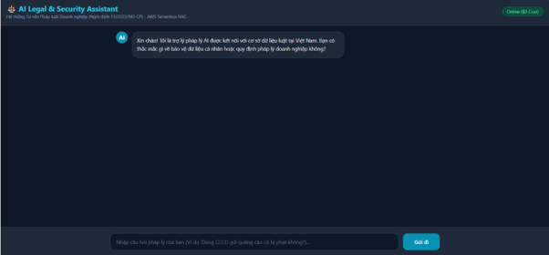
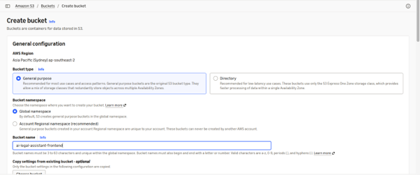
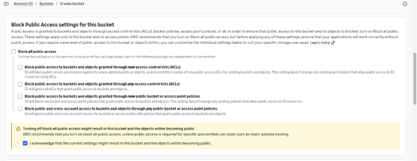
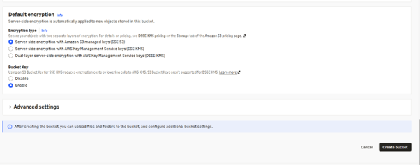
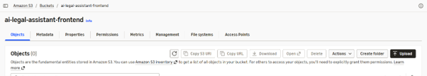
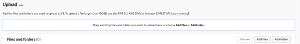
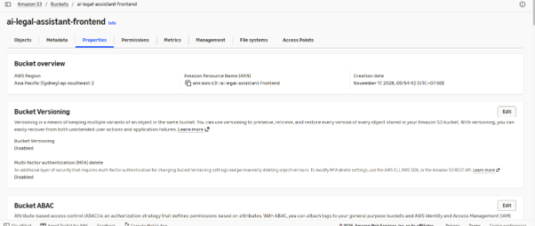
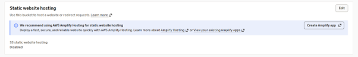
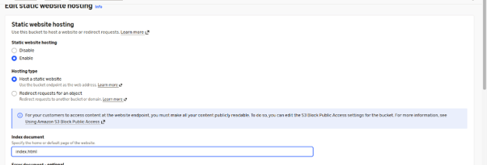

#### Overview

| Item | Content |
| ---- | ------- |
| Purpose | A chat page where users ask questions and read the answers |
| AWS services | Amazon S3 (static website hosting) |
| Input | User question |
| Output | Rendered answer in the chat box |
| Depends on | Backend API URL |

#### 5.5.1. Build the chat page (index.html)

**Goal**

A single static page that talks to the backend with fetch.

**Steps**
1. Build the chat layout: title, status badge, welcome message, message list, input box and send button.
2. On send, call fetch with an HTTP POST to the API URL and show a loading state.
3. Show a clear message for errors (400, 429, 502/504).
4. Recommended: add a visible disclaimer that answers are preliminary and not legal advice.

**Verify**

Opening index.html locally shows the chat page and the welcome message.

#### 5.5.2. Host the page on S3

**Goal**

Publish index.html as a static website.

**Steps**
1. Create the bucket ai-legal-assistant-frontend-hau in ap-southeast-2.
2. Upload index.html.
3. Enable Static website hosting with index.html as the index document.
4. Allow public read of this bucket only (turn off Block Public Access for it and add a read-only bucket policy).
5. Open the website endpoint.

**Verify**

The endpoint http://<bucket>.s3-website-ap-southeast-2.amazonaws.com loads the page.

#### 5.5.3. Connect to the API and test end-to-end

**Goal**
Make the live page call the real backend.

**Steps**
1. Set the API invoke URL in index.html and re-upload it.
2. Open the live site and ask the sample question.
3. Open the browser developer console and check there is no CORS error.
4. Check the request in CloudWatch Logs.

**Verify**

Question → grounded answer on the page, with a matching log entry.