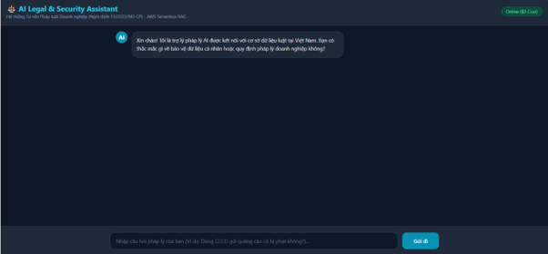
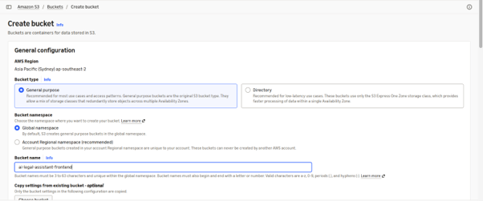
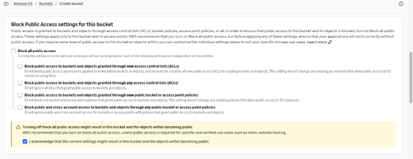
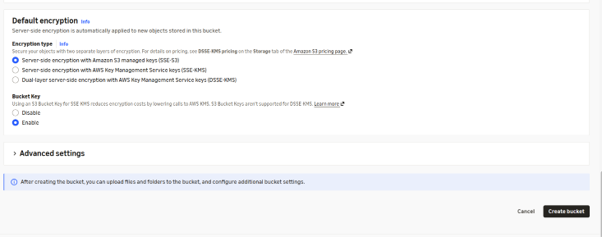
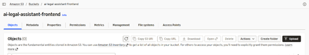
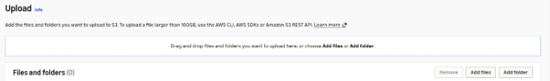
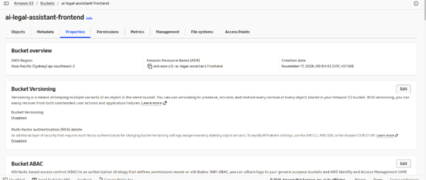
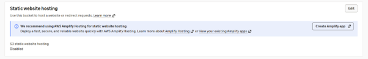
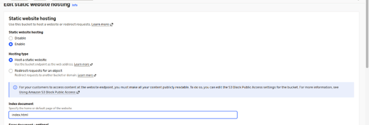

#### Tổng quan

| Mục | Nội dung |
| --- | -------- |
| Mục đích | Trang chat để người dùng đặt câu hỏi và đọc câu trả lời. |
| Dịch vụ AWS | Amazon S3 (static website hosting) |
| Đầu vào | Câu hỏi người dùng |
| Đầu ra | Câu trả lời hiển thị trong khung chat |
| Phụ thuộc | URL của Backend API |

#### 5.5.1. Dựng giao diện chat (index.html)

**Mục tiêu**

Một trang tĩnh duy nhất gọi backend bằng fetch.

**Các bước**
1. Dựng bố cục chat: tiêu đề, badge trạng thái, lời chào, danh sách tin nhắn, ô nhập và nút gửi.
2. Khi gửi, gọi fetch bằng HTTP POST tới URL API và hiển thị trạng thái đang xử lý.
3. Hiển thị thông báo rõ ràng cho các lỗi (400, 429, 502/504).
4. Khuyến nghị: thêm disclaimer hiển thị rằng câu trả lời là sơ bộ, không phải tư vấn pháp lý.

**Kiểm tra**

Mở index.html trên máy thấy trang chat và lời chào.

#### 5.5.2. Host trang trên S3

**Mục tiêu**

Công khai index.html dưới dạng static website.

**Các bước**
1. Tạo bucket ai-legal-assistant-frontend-hau ở ap-southeast-2.
2. Tải index.html lên.
3. Bật Static website hosting với index.html làm index document.
4. Cho phép đọc công khai riêng bucket này (tắt Block Public Access cho nó và thêm bucket policy chỉ đọc).
5. Mở website endpoint.

1: Tạo bucket S3 ở region ap-southeast-2, loại General purpose, đặt tên bucket.

2: Bỏ chọn Block all public access cho riêng bucket này và xác nhận cảnh báo.

3: Giữ mã hóa mặc định SSE-S3 và chọn Create bucket.

4: Bucket đã được tạo, danh sách Objects đang trống.

5: Trang Upload để tải file index.html lên bucket.

**Kiểm tra**

Endpoint http://<bucket>.s3-website-ap-southeast-2.amazonaws.com mở được trang.

#### 5.5.3. Connect to the API and test end-to-end

**Mục tiêu**
Cho trang đã deploy gọi backend thật.

**Các bước**
1. Đặt URL gọi API trong index.html và tải lại lên.
2. Mở website và hỏi câu hỏi mẫu.
3. Mở console của trình duyệt và kiểm tra không có lỗi CORS.
4. Kiểm tra request trong CloudWatch Logs.

1: Tab Properties của bucket, xem thông tin Region, ARN và ngày tạo.

2: Mục Static website hosting đang ở trạng thái Disabled, chọn Edit.

3: Bật Static website hosting, chọn Host a static website và đặt Index document là index.html.

**Kiểm tra**

Câu hỏi → câu trả lời có căn cứ trên trang, kèm một dòng log tương ứng.