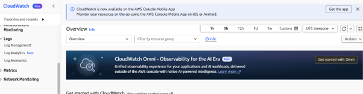
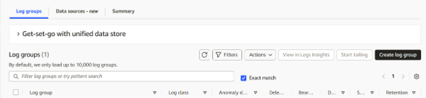
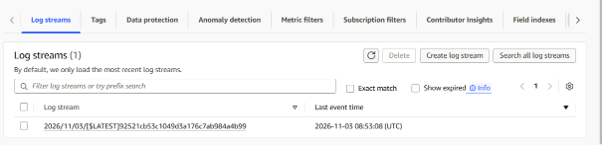
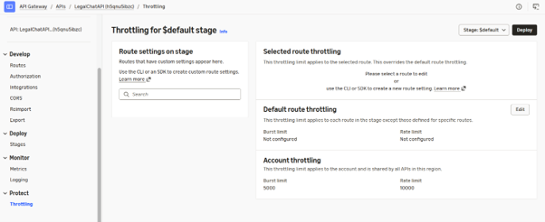
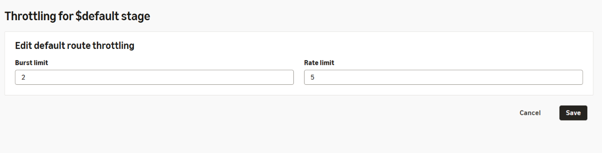

#### Overview

| Item | Content |
| ---- | ------- |
| Purpose | Know the current security posture, monitor behavior and cost, and plan improvements |
| AWS services | CloudWatch, AWS Budgets, IAM |

#### 5.6.1. Current security status

| Area | Current state | Risk | Recommendation |
| ---- | ------------- | ---- | -------------- |
| API Gateway | Public, no authentication | Anyone with the URL can call it and use up the Groq quota | Throttling + usage plan / API key; Cognito later |
| CORS | Access-Control-Allow-Origin: * | Any website can call the API from a browser | Restrict to the S3 site origin after the demo |
| Groq API key | Lambda environment variable | Exposed if committed or screenshotted | Move to SSM Parameter Store (SecureString); rotate if leaked |
| S3 website | Public read, HTTP only | Traffic is not encrypted | Put CloudFront in front for HTTPS if needed |
| Data sent to Groq | Questions leave AWS | Real customer data could leak outside the account | Sample questions only; review Groq's data policy; consider Bedrock |
| CloudWatch | Lambda logs enabled | Logs may contain user questions | Set retention (7-14 days); avoid logging sensitive text |

#### 5.6.2. Monitoring and cost control

**Goal**

Detect errors and unexpected cost early.

**Steps**
1. Set a log retention period on the Lambda log group.
2. Create an alarm for Lambda errors (optional).
3. Check the Billing Free Tier usage page regularly and keep the Budget alert from 5.2.

1: In the CloudWatch dashboard, go to the "Logs" section to view Lambda logs.

2: The list of log groups includes those automatically created by Lambda for your Lambda functions.

3: The list of log streams contains individual streams, each recording function requests along with the timestamp of the most recent log entry.

**Verify**

A test request appears in the logs; the Budget alert is active.

#### 5.6.3. Hardening roadmap

1. Add API throttling and a usage plan to protect the Groq quota (high priority, no code change in the frontend).
2. Move the Groq key to SSM Parameter Store and grant Lambda read access to that one parameter.
3. Restrict CORS to the website origin.
4. Add Cognito sign-in if the system leaves demo mode.
5. Test: call the API at high speed and confirm throttling; try prompt-injection questions; scan the repository for secrets.

1: The stage-level Throttling page, which displays the currently applied limits.
* **Stage:** Select the desired stage in the top-right corner (currently set to `$default`). Each stage has its own throttling configuration.
* **Selected route throttling:** Limits applied to individual routes (overriding the default settings). This section is currently empty as no route has been selected.
* **Default route throttling:** Limits applied to all routes within the stage. Currently, both **Burst limit** and **Rate limit** are marked as **Not configured**, meaning no limits are in place.
* **Account throttling:** A global limit for the entire account within a region (Burst 5000, Rate 10000), which applies to all APIs. This is a system-level setting and cannot be modified here.
* Select **Edit** under the **Default route throttling** section.  
Set the default limits.

2: Set the Burst limit to 2 and the Rate limit to 5 for the default route.
* **Rate limit:** 5, the maximum average number of requests per second.
* **Burst limit:** 2, the maximum number of requests that can be processed simultaneously during a sudden surge.
* Select **Save**, then select **Deploy** to apply the changes.  
Requests that exceed these limits will receive a **429 Too Many Requests** error from API Gateway, before reaching Lambda and Groq.