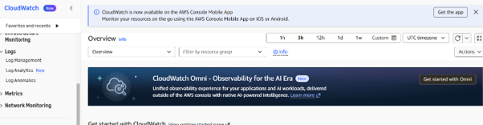
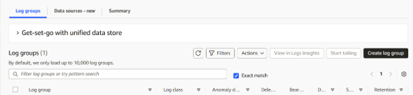
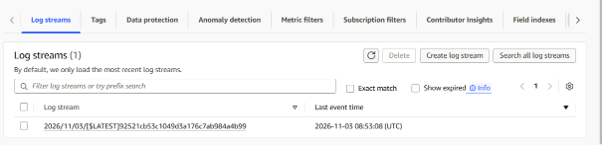
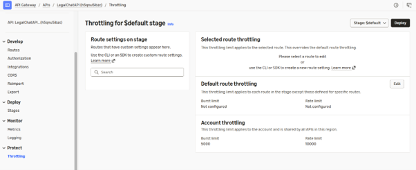
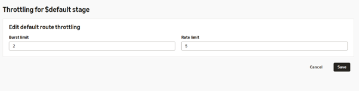

#### Tổng quan

| Mục | Nội dung |
| --- | -------- |
| Mục đích | Nắm hiện trạng bảo mật, giám sát hoạt động và chi phí, và lập kế hoạch cải tiến |
| Dịch vụ AWS | CloudWatch, AWS Budgets, IAM |

#### 5.6.1. Hiện trạng bảo mật

| Hạng mục | Hiện trạng | Rủi ro | Khuyến nghị |
| -------- | ---------- | ------ | ----------- |
| API Gateway | Công khai, chưa xác thực | AAi có URL cũng gọi được và làm cạn quota Groq | Throttling + usage plan / API key; Cognito sau |
| CORS | Access-Control-Allow-Origin: * | Mọi website đều gọi được API từ trình duyệt | Giới hạn theo origin của trang S3 sau demo |
| Groq API key | Biến môi trường của Lambda | Lộ nếu bị commit hoặc chụp màn hình | Chuyển sang SSM Parameter Store (SecureString); đổi key nếu lộ |
| S3 website | Đọc công khai, chỉ HTTP | Lưu lượng không được mã hóa | Đặt CloudFront phía trước để có HTTPS nếu cần |
| Dữ liệu gửi tới Groq | Câu hỏi rời khỏi AWS | Dữ liệu khách hàng thật có thể ra ngoài tài khoản | Chỉ dùng câu hỏi mẫu; xem chính sách dữ liệu của Groq; cân nhắc Bedrock |
| CloudWatch | Đã bật log Lambda | Log có thể chứa câu hỏi người dùng | Đặt thời gian lưu (7-14 ngày); tránh log nội dung nhạy cảm |

#### 5.6.2. Giám sát và kiểm soát chi phí

**Mục tiêu**

Phát hiện sớm lỗi và chi phí bất thường.

**Các bước**
1. Đặt thời gian lưu log cho log group của Lambda.
2. Tạo alarm cho lỗi Lambda (tùy chọn).
3. Thường xuyên xem trang Free Tier usage trong Billing và giữ cảnh báo Budget ở mục 5.2.

1: Trang tổng quan CloudWatch, vào mục Logs để xem log của Lambda.

2: Danh sách Log groups, log group của hàm Lambda do Lambda tự tạo.

3: Danh sách Log streams, mỗi stream ghi lại các request của hàm kèm thời điểm log gần nhất.

**Kiểm tra**

Request thử nghiệm xuất hiện trong log; cảnh báo Budget đang hoạt động.

#### 5.6.3. Lộ trình siết bảo mật

1. Thêm throttling và usage plan cho API để bảo vệ quota Groq (ưu tiên cao, không phải sửa frontend).
2. Chuyển Groq key sang SSM Parameter Store và chỉ cấp cho Lambda quyền đọc đúng parameter đó.
3. Giới hạn CORS theo origin của website.
4. Thêm đăng nhập Cognito nếu hệ thống ra khỏi chế độ demo.
5. Kiểm thử: gọi API với tốc độ cao để xác nhận throttling; thử câu hỏi prompt injection; quét repository tìm secret.

1: Trang Throttling của stage, hiển thị các mức giới hạn đang áp dụng.
* **Stage:** chọn stage cần giới hạn ở góc phải trên (ảnh đang ở $default). Mỗi stage có cấu hình throttling riêng.
* **Selected route throttling:** giới hạn riêng cho từng route (ghi đè mức mặc định). Mục này đang trống vì chưa chọn route nào.
* **Default route throttling:** giới hạn áp dụng cho mọi route trong stage. Hiện **Burst limit** và **Rate limit** đều ghi **Not configured**, nghĩa là chưa giới hạn gì.
* **Account throttling:** mức trần chung của cả tài khoản trong region (Burst 5000, Rate 10000), dùng chung cho mọi API. Đây là mức hệ thống, không chỉnh ở đây.
* Chọn **Edit** ở mục **Default route throttling**.  
Đặt giới hạn mặc định

2: Đặt Burst limit = 2 và Rate limit = 5 cho route mặc định
* **Rate limit:** 5, số request trung bình tối đa mỗi giây.
* **Burst limit:** 2, số request tối đa được xử lý đồng thời trong một đợt tăng đột biến.
* Chọn **Save**, sau đó chọn **Deploy** để áp dụng.  
Request vượt giới hạn sẽ nhận lỗi **429 Too Many Requests** từ API Gateway, trước khi tới Lambda và Groq.