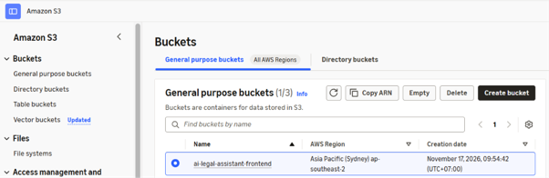
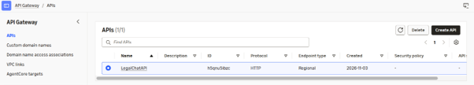
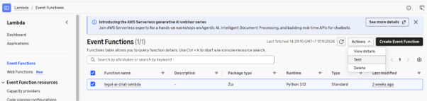
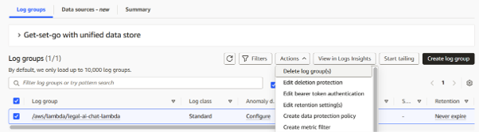
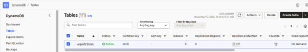
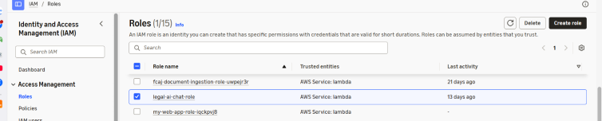
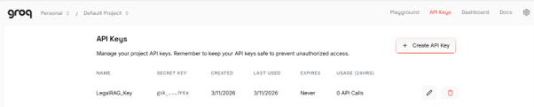

#### Delete resources in the following order to avoid dependency errors and unnecessary costs:

1: S3 bucket `ai-legal-assistant-frontend-hau`.

2: API in API Gateway.

3: Lambda function and its associated CloudWatch log group.

4: DynamoDB table `LegalArticles`.

5: IAM role created for the Lambda function.

6: Revoke the Groq API key via the Groq console.
