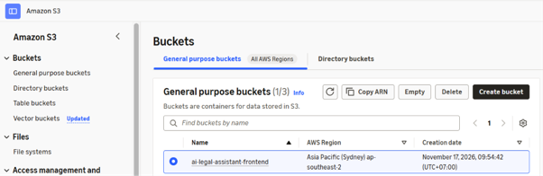
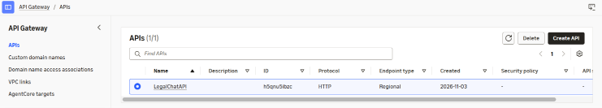
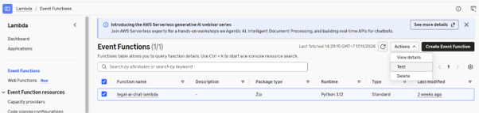
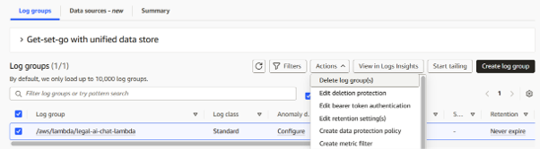
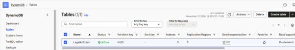
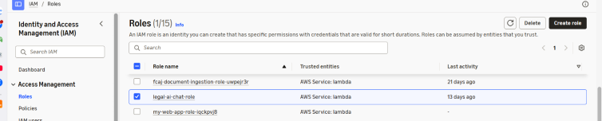
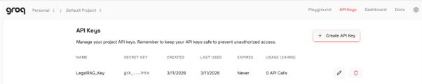

#### Xóa tài nguyên theo thứ tự sau để tránh lỗi phụ thuộc và chi phí phát sinh:

1: S3 bucket ai-legal-assistant-frontend-hau.

2: API trong API Gateway.

3: Hàm Lambda và log group CloudWatch của nó.

4: Bảng DynamoDB LegalArticles.

5: IAM role tạo cho Lambda.

6: Thu hồi Groq API key trong Groq console.

